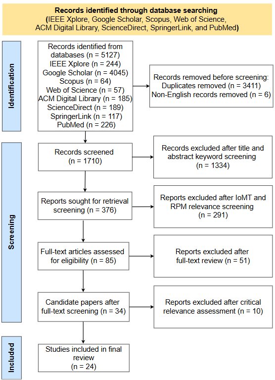
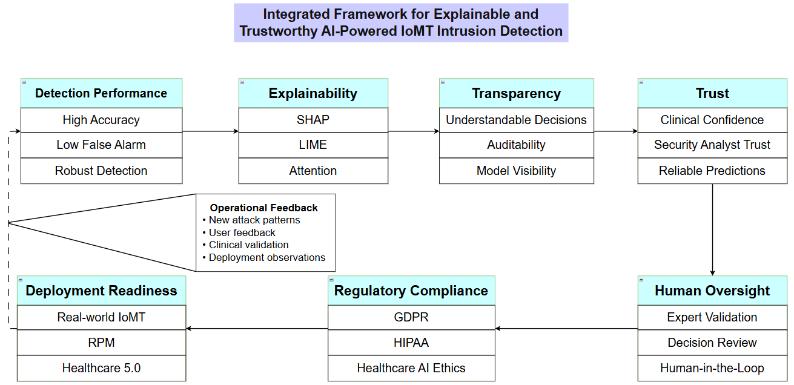

# Trustworthy AI-Powered Intrusion Detection for the Internet of Medical Things (IoMT): A Review

**Jahidul Islam, Dristi Datta and Fowzia Akhter**
*Sensors* 2026, 26(16), 5182 · Published 16 August 2026 · [doi:10.3390/s26165182](https://doi.org/10.3390/s26165182)

This is the companion repository to a published **structured narrative review guided by PRISMA 2020**. It documents:
- the review's methodology
- its quality-assessment framework
- its six-dimension analytical framework
- the evidence base of 24 primary studies

The review synthesises the existing literature. It did **not** develop, train or benchmark a new intrusion detection model, and the repository contains no model code.

---

## The problem

The IoMT connects wearable sensors, implantable devices, electronic health records and Remote Patient Monitoring (RPM) platforms with cloud and edge infrastructure. This enables continuous care, but it also widens the healthcare attack surface. Resource-constrained devices, heterogeneous protocols and safety-critical clinical workflows expose IoMT systems to ransomware, malware, denial-of-service, spoofing, unauthorised access, data manipulation and attacks on AI-enabled services. Signature-based defences address these threats poorly.

## Purpose and contribution of the review

AI-based intrusion detection systems (IDSs) frequently report benchmark accuracies above 95%, yet few reach routine clinical deployment. The review asks why. It:

1. Synthesises 2021–2026 evidence on AI-powered IDSs for IoMT across six analytical dimensions.
2. Links technical performance to the operational and clinical requirements of RPM and Healthcare 5.0 settings.
3. Identifies five interconnected research gaps:
   - benchmark-specific learning
   - resource constraints
   - limits of collaborative intelligence
   - incomplete integration of trustworthy AI
   - accuracy-centred evaluation
4. Proposes a deployment-readiness checklist and strategic research priorities.

Its central conclusion is that **deployment readiness, not benchmark accuracy, is the defining challenge** for next-generation healthcare cybersecurity.

## Methodology

- **Design:** structured narrative review. PRISMA 2020 guided record identification, screening and reporting. Evidence is synthesised qualitatively, with no meta-analysis.
- **Search:** eight databases, covering studies published 2021–2026 in English, with a common Boolean search string:
  - IEEE Xplore
  - Google Scholar
  - Scopus
  - Web of Science
  - ACM Digital Library
  - ScienceDirect
  - SpringerLink
  - PubMed
- **Selection (as reported):**
  - 5,127 records identified
  - duplicate removal, then title and abstract screening
  - full-text eligibility assessment of 85 articles
  - quality assessment of the 34 studies that passed full-text eligibility
  - **24 primary studies** included, supported by **115 complementary references**
- **Details:** [`methodology/SEARCH_STRATEGY.md`](methodology/SEARCH_STRATEGY.md) and [`methodology/STUDY_SELECTION.md`](methodology/STUDY_SELECTION.md).

<p align="center"></p>
<p align="center"><sub>Figure 1 of the article: PRISMA flow with reported counts. © 2026 the authors, CC BY 4.0.</sub></p>

## Quality assessment: five criteria

Of the 85 full-text articles assessed for eligibility, 34 passed and entered methodological quality assessment. Each of these 34 studies was scored from 0 to 2 on each of five criteria, for a maximum of 10. Studies scoring 5 or more were included.

| | Criterion |
|---|---|
| Q1 | Relevance to IoMT intrusion detection and healthcare cybersecurity |
| Q2 | Methodological transparency and reproducibility |
| Q3 | Dataset description and evaluation reporting |
| Q4 | Experimental or comparative validation |
| Q5 | Contribution to explainability, privacy preservation, deployment readiness, or broader healthcare cybersecurity |

The article reports that 24 of the 34 candidates were included (20 strong, scoring 8–10; 4 moderate, scoring 5–7) and 10 were excluded. See [`methodology/QUALITY_ASSESSMENT.md`](methodology/QUALITY_ASSESSMENT.md).

## Six analytical dimensions

| Dimension | Focus |
|---|---|
| Detection performance | The progression from traditional ML through deep learning to hybrid and ensemble architectures |
| Explainability | SHAP, LIME, attention, and interpretable and ensemble models; trust and human oversight |
| Privacy preservation | Federated Learning, blockchain-assisted trust, secure aggregation |
| Computational efficiency | Latency, memory and energy on wearable, implantable and edge devices |
| Benchmarking practices | Dataset concentration and accuracy-centred metrics |
| Cross-dataset generalisation | Performance on unseen datasets, devices and institutions |

See [`methodology/SIX_DIMENSION_FRAMEWORK.md`](methodology/SIX_DIMENSION_FRAMEWORK.md).

<p align="center"></p>
<p align="center"><sub>Figure 5 of the article. © 2026 the authors, CC BY 4.0.</sub></p>

## Main findings

- **Detection capability has advanced quickly.** Recent advances are increasingly driven by architectural integration rather than by entirely new learning algorithms.
- **Other dimensions have lagged.** Progress in explainability, privacy-preserving collaboration, efficiency, benchmarking consistency and generalisation has not kept pace with detection capability. This helps explain why strong benchmark results seldom translate into deployable systems.
- **Collaborative approaches are promising but constrained.** Federated Learning and blockchain complement each other, but non-IID data, communication overhead, poisoning attacks and consensus latency limit them.

## Deployment challenges

- Limited cross-dataset generalisation
- Computational constraints on medical and edge devices
- Concept drift in dynamic healthcare environments
- Weak integration with clinical workflows, leading to alert fatigue
- Accuracy-centred evaluation
- Limited scalability and interoperability

## Future research opportunities

- Generalisable AI: cross-dataset and multi-centre validation, domain adaptation, continual learning
- Resource-aware intelligence: TinyML, model compression, edge-native inference
- Secure multi-institutional collaboration: personalised FL, secure aggregation, lightweight blockchain
- Trustworthy, human-centred AI: explainable, auditable, clinician-in-the-loop
- Standardised, deployment-oriented evaluation: latency, energy, memory, robustness, interoperability and usability alongside accuracy

## Citation

```bibtex
@article{islam2026trustworthy,
  title   = {Trustworthy AI-Powered Intrusion Detection for the Internet of Medical Things (IoMT): A Review},
  author  = {Islam, Jahidul and Datta, Dristi and Akhter, Fowzia},
  journal = {Sensors},
  volume  = {26},
  number  = {16},
  pages   = {5182},
  year    = {2026},
  doi     = {10.3390/s26165182}
}
```

See also [`CITATION.cff`](CITATION.cff) and the published author contributions in [`CONTRIBUTION.md`](CONTRIBUTION.md).

## Repository contents

```text
CONTRIBUTION.md              Published author contributions, funding, data availability and declarations
CITATION.cff                 Citation metadata for the published article
methodology/                 Search strategy, study selection, quality assessment, six-dimension framework
analysis/                    The 24 primary studies, published quality scores, comparison matrix
evidence/original/           Metadata-only derivatives of original search and (partial) screening records,
                             and the original extraction matrices
evidence/published_transcriptions/
                             Tables 2, 4, 6, 7 and Figure 1 counts transcribed from the article
evidence/EVIDENCE_PROVENANCE.md
                             Source, checksum and derivation of every evidence file
figures/                     Figures 1 and 5 of the article (CC BY 4.0)
figures/FIGURE_SOURCES.md    Source, licence and captions of the reproduced figures
reproducibility/             Reproducibility scope and a consistency-check script
```

## Reproducibility scope

This repository supports **inspection and consistency checking**, not complete reproduction of the review workflow. [`reproducibility/verify_package.py`](reproducibility/verify_package.py) checks the arithmetic and internal consistency of the published counts, quality scores and study tables. It also compares the reported counts with the original Google Scholar and IEEE Xplore exports and the historical, partial Zotero screening records; the original extraction matrices are provided for inspection. The full 5,127-record search, the published PRISMA stages and the original per-criterion scores cannot be recomputed from these records, and fields that could not be independently checked are marked **NOT VERIFIED**.

See [`reproducibility/REPRODUCIBILITY.md`](reproducibility/REPRODUCIBILITY.md) for what can and cannot be verified, and [`evidence/EVIDENCE_PROVENANCE.md`](evidence/EVIDENCE_PROVENANCE.md) for the source of each evidence file. Full-text articles and database abstracts are not redistributed.

## Licence

The article is open access under [CC BY 4.0](https://creativecommons.org/licenses/by/4.0/). The figures and transcriptions reproduced here are attributed to it. The authors have not yet chosen a licence for the repository's own documentation.
